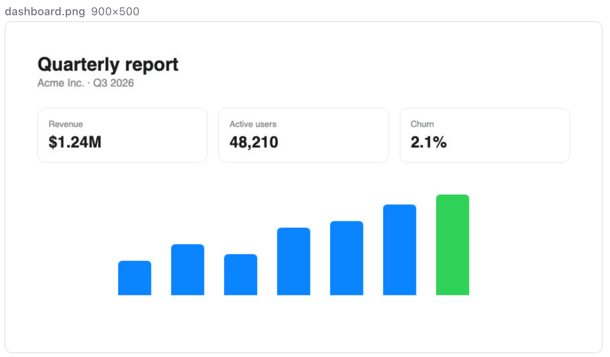
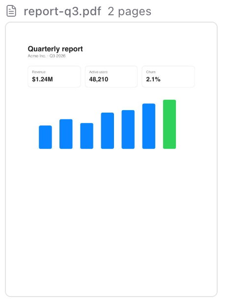
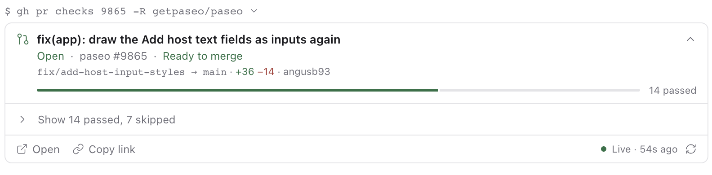
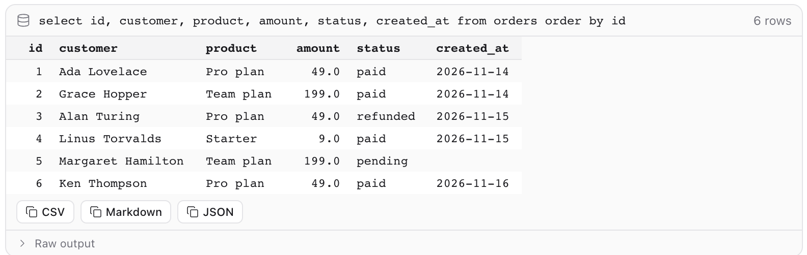
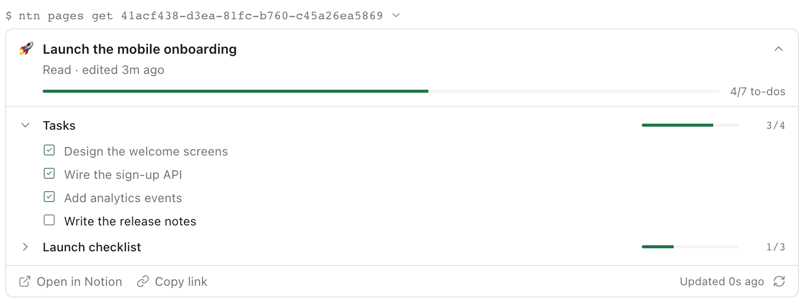
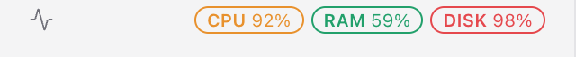

# Paseo curated plugins

Plugins for [Paseo](https://paseo.sh). They turn what an agent does into something you can see at a glance. Each directory is a standalone plugin; its `OVERVIEW.md` has the details.

## Install

Enable plugins once (`"pluginsEnabled": true` at the top level of `~/.paseo/config.json`, then `paseo reload`), then:

```bash
paseo plugin install "git:https://github.com/plfavreau/paseo-curated-plugins.git:<plugin>"
```

Reload the Paseo app to load the new client code. `paseo plugin update <plugin>` pulls later changes.

## In the conversation

### [`image-preview`](./image-preview)
Images the agent reads show as thumbnails, with a full-size viewer and download. Needs `ffmpeg`.



### [`pdf-preview`](./pdf-preview)
PDFs the agent reads or runs a command on (`Read`, `pdftotext`…) show their first page, with a page-by-page viewer. Needs `poppler`.



### [`pr-card`](./pr-card)
`gh pr` commands become a live PR card: CI jobs as they run and fail, review and merge state, re-run failed jobs. Needs `gh`.



### [`sql-table`](./sql-table)
Query output (psql, Supabase, sqlite, MySQL…) shows as a table: tap a row to read it, copy as CSV, Markdown or JSON.



### [`notion-card`](./notion-card)
`ntn` commands on a Notion page become a live card: status, properties, to-do lists and their progress. Needs the [Notion CLI](https://ntn.dev).



### [`quote-selection`](./quote-selection)
Select text in a message and press Q to quote it into the prompt.

## Around it

### [`system-health`](./system-health)
CPU, RAM and disk pills in the sidebar, with a button that sends a cleanup prompt to a session you pick.



### [`ai-accounts`](./ai-accounts)
Several Claude subscriptions, with usage per account and conversations spread across them. Setup and OpenAI handoff: [ai-accounts/README.md](./ai-accounts/README.md).


### [`pin-notes`](./pin-notes)
Pin notes and links to a conversation, shown as pills above the composer.

## License

MIT
